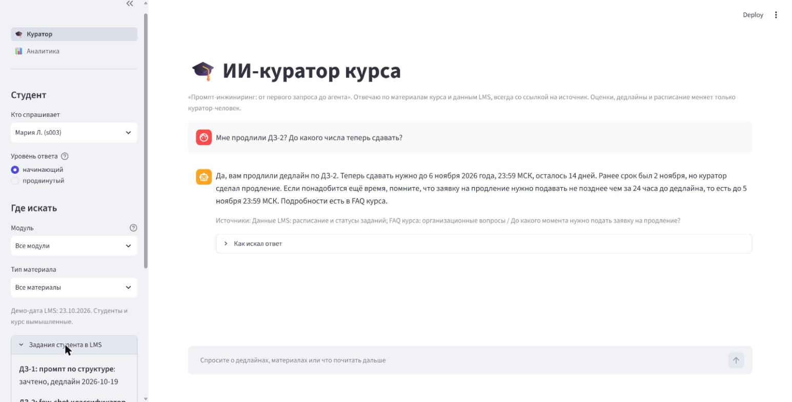
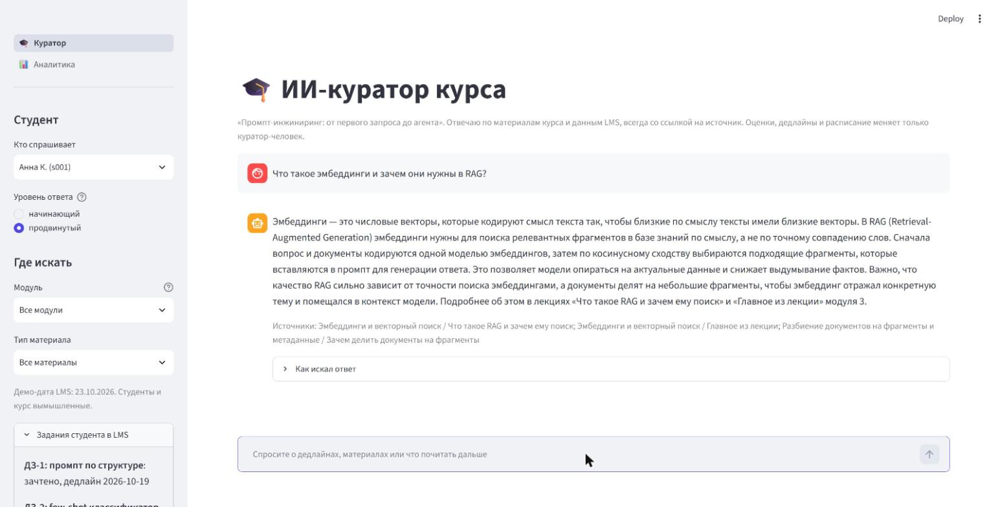
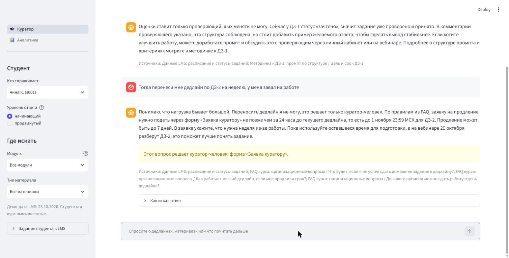
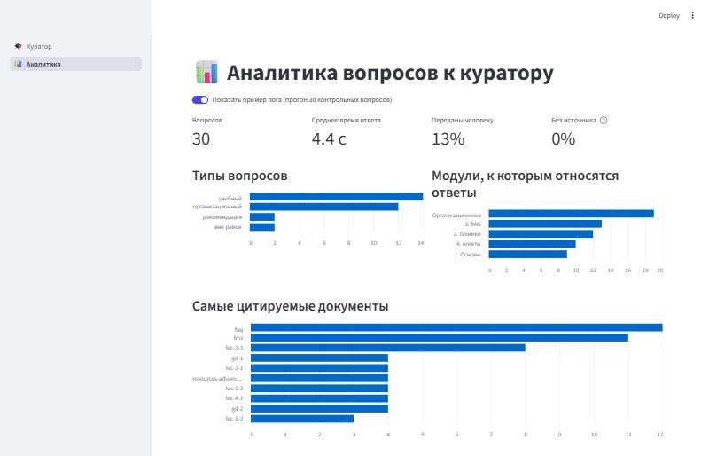
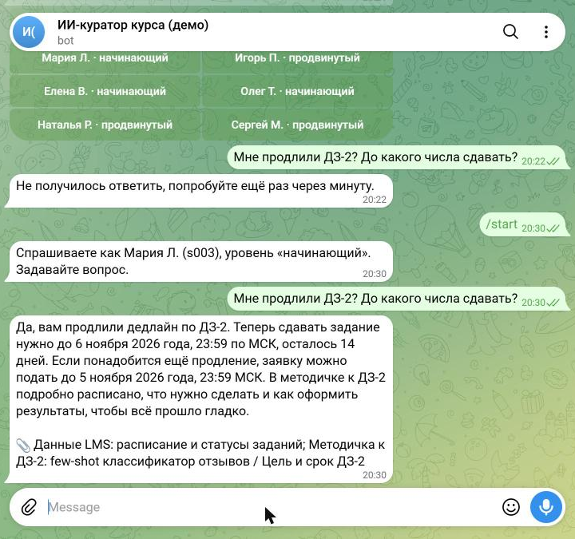
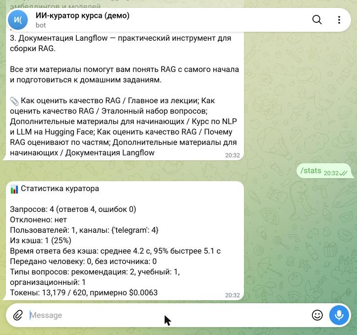

# ИИ-куратор для образовательной платформы

ИИ-куратор онлайн-курса. Он помогает студенту:
- ориентироваться в материалах;
- отвечает на организационные и учебные вопросы;
- рекомендует, что почитать дальше, с учётом уровня подготовки.

Каждый ответ идёт со ссылкой на источник. Оценки, дедлайны и расписание куратор не трогает: такие вопросы он передаёт куратору-человеку.

Учебный проект. Курс «Промпт-инжиниринг: от первого запроса до агента», школа «Вектор», студенты и их данные вымышлены.

**Демо:** https://ai-curator-vector.streamlit.app (лимит 15 вопросов за сессию)
**Telegram-бот:** [@dgmagic_curator_bot](https://t.me/dgmagic_curator_bot) (лимит 20 вопросов в день)



## Что умеет

- **Отвечает по материалам курса (RAG).** Знания берёт из 12 лекций, 4 методичек к домашним заданиям, FAQ из 32 вопросов и двух списков дополнительных материалов. Источник показан под каждым ответом.
- **Знает расписание и прогресс студента.** Заглушка LMS хранит дедлайны, статусы заданий, персональные продления и вебинары. Сроки куратор называет точно: сколько дней осталось и до какого числа подать заявку на продление.
- **Подстраивается под уровень.** Начинающему объясняет простыми словами с бытовой аналогией, продвинутому отвечает сжато, с компромиссами и способами проверки.
- **Ищет с фильтрами.** Можно искать по модулю, теме и типу материала, материалы чужого уровня скрыты.
- **Держит границы.** Не ставит оценки, не переносит дедлайны, не делает задания за студента, не раскрывает чужие данные, не поддаётся prompt injection. Там, где решает человек, показывает пометку «передать куратору».
- **Работает на сайте и в Telegram.** Оба канала идут через один обработчик и пишут в один лог.
- **Логирует каждый запрос и считает метрики.** Ответ, отказ с причиной или ошибка, время ответа, токены, кэш. Логи обезличены. Подробнее в разделе ниже.
- **Собирает аналитику.** Дашборд показывает типы вопросов, модули, самые цитируемые документы и вопросы, на которые в базе нет ответа.

| Новичок | Продвинутый |
|---|---|
|  |  |

| Ограничения и передача человеку | Аналитика |
|---|---|
|  |  |

## Качество (eval на 30 контрольных вопросах)

| Метрика | Результат |
|---|---|
| Нужный документ найден поиском | 24/24 (100%) |
| Передача человеку там, где нужно | 27/27 (100%) |
| Учебные ответы со ссылкой на источник | 16/16 (100%) |
| Провокации (оценка, перенос дедлайна, «сделай за меня», вне курса, инъекция) | 5/5 отработаны корректно, проверено вручную |

Было 5 прогонов, по каждому записано, что нашли и что исправили: [eval/report.md](eval/report.md). Главный урок: даты считает код, а не модель. Модель ошибалась на день в сроке подачи заявки, и автоматические метрики этого не замечали.

## Логирование и метрики

Каждый запрос, с сайта или из Telegram, проходит через `curator/service.py` и пишется одной строкой в SQLite (`curator/db_logger.py`):

```
запрос → проверка → отклонён (причина: пустой, длиннее 1000 символов, дневной лимит)
                  → принят → ответ из кэша или от модели → «answered»
                                                       → модель упала → «error»
```

| Что пишется | Зачем |
|---|---|
| время, канал (web, telegram), статус, причина отказа | что сломалось, где и когда |
| вопрос, ответ, категория, источники, «передано человеку» | разбор качества и пробелов в базе |
| время ответа, токены, флаг кэша | скорость и стоимость |
| хеш пользователя, демо-студент, уровень | сколько людей и как спрашивают, без личных данных |

**Безопасность логов.**
- Вместо id пользователя хранится SHA-256 с секретной солью, имён и username нет.
- Телефоны и почты в вопросах заменяются на `[телефон]` и `[email]` до записи.
- Записи старше 90 дней удаляются при старте.
- `/stats` и `/export` в боте доступны только администратору.

**Кэш.** Ответ на учебный вопрос общий для всех студентов: повтор приходит за миллисекунды, без вызова модели. Ответ, построенный на данных LMS (дедлайны, статусы), кэшируется только для того же студента: чужой дедлайн никто не увидит. Уточняющие вопросы в диалоге кэш не используют. Срок хранения 7 дней.

**Метрики** видны в `/stats` бота и на странице «Аналитика»:
- запросы, отказы по причинам, ошибки;
- доля кэша;
- среднее время и 95-й перцентиль;
- типы вопросов, передачи человеку, ответы без источника;
- токены и примерная стоимость.

`/export` присылает администратору CSV.

| Бот: продлённый дедлайн | Бот: /stats |
|---|---|
|  |  |

Первая живая проверка в Telegram, 4 запроса:
- 1 из кэша (0 мс вместо 5 с);
- среднее время ответа 4,2 с, 95% быстрее 5,1 с;
- стоимость около $0,006.

## Как устроено

```
вопрос → FAISS (top-4 + 2 доп. материала, фильтр по модулю/типу/уровню)
       → промпт: роль и правила + блок уровня + few-shot + данные LMS + фрагменты
       → gpt-4.1-mini (OpenRouter, structured output) → ответ, источники, категория, «нужен человек»
       → лог SQLite → /stats бота и дашборд
```

- Модели: `openai/gpt-4.1-mini` и `openai/text-embedding-3-small` через OpenRouter (API, совместимый с OpenAI). Один ответ стоит около $0,002.
- Стек: Python 3.12, LangChain, FAISS, SQLite, Streamlit, python-telegram-bot.
- Подробности:
  - [архитектура промптов и RAG](docs/ARCHITECTURE.md);
  - [обновление базы и переиндексация](docs/UPDATE_KB.md);
  - [логирование и аналитика](docs/ANALYTICS.md);
  - [выкладка бота на сервер](docs/DEPLOY.md).

```
app.py                 вход и навигация сайта
bot.py                 Telegram-бот
views/                 страницы «Куратор» и «Аналитика»
curator/               поиск (kb.py), заглушка LMS (lms.py), цепочка ответа (chain.py),
                       обработчик запросов (service.py), лог и кэш в SQLite (db_logger.py)
prompts/               системный промпт, блоки уровня, few-shot примеры
kb/                    база знаний: лекции, методички, FAQ, доп. материалы (Markdown + метаданные)
lms/                   расписание (JSON), студенты и статусы заданий (CSV)
index/                 готовый индекс FAISS
eval/                  контрольные вопросы, прогон, отчёты
tests/                 тесты без сети
deploy/                служба systemd, зависимости бота, пример .env
```

## Запуск локально

Нужен [uv](https://docs.astral.sh/uv/) и ключ [OpenRouter](https://openrouter.ai/keys).

```bash
uv sync
```

```bash
export OPENROUTER_API_KEY=sk-or-...
```

```bash
uv run streamlit run app.py
```

Тесты (без сети):

```bash
uv run pytest
```

Прогон eval (около $0,06):

```bash
uv run python eval/run_eval.py
```

## Деплой в Streamlit Community Cloud

1. New app → этот репозиторий, ветка `main`, файл `app.py`, Python 3.12.
2. Settings → Secrets: `OPENROUTER_API_KEY = "sk-or-..."`. Пример лежит в `.streamlit/secrets.toml.example`.
3. **Возьмите для демо отдельный ключ OpenRouter с лимитом расходов**, например $2: публичное демо тратит деньги с этого ключа. В приложении стоит лимит 15 вопросов на сессию и 1000 символов на вопрос.

Индекс в облаке не строится, он лежит в репозитории.
