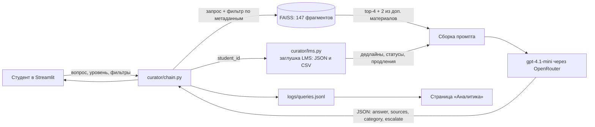

# Архитектура ИИ-куратора: промпты и RAG

## Схема

## Индексация

- База знаний лежит в `kb/`: 12 лекций, 4 методички, FAQ, 2 списка дополнительных материалов. Это Markdown с front matter.
- Каждый документ размечен 7 полями. Все они попадают в метаданные фрагментов:

| Поле | Значения | Зачем |
|---|---|---|
| `doc_id` | lec-2-1, gd-3, faq, resources-beginner | цитирование, проверка поиска |
| `title`, `module_title` | текст | ссылка на источник в ответе |
| `module` | 0–4 (0 = организационное) | фильтр по модулю |
| `topic` | короткая тема | фильтр по теме |
| `type` | лекция, методичка, faq, ресурсы | фильтр по типу ресурса |
| `level` | все, начинающий, продвинутый | персонализация рекомендаций |

- Фрагмент равен разделу `##`. Раздел отвечает на один вопрос, и на него удобно сослаться как «Документ / Раздел». Разделы длиннее 1500 символов дробятся по 1200 символов с перекрытием 150. Сейчас таких нет, самый длинный фрагмент 1167 символов.
- В текст фрагмента добавлено название документа: так поиск находит раздел, даже если в нём самом не названа тема.
- Эмбеддинги делает `openai/text-embedding-3-small` через OpenRouter, индекс хранится в FAISS в папке `index/`. Полная переиндексация стоит меньше $0,01, подробнее в `UPDATE_KB.md`.

## Поиск

- По вопросу берутся top-4 фрагмента по косинусной близости, сразу с фильтром по метаданным (`curator/kb.py`, `make_filter`). Если тип ресурса не выбран, к ним добавляются 2 лучших фрагмента из дополнительных материалов. Без этих мест лекции вытесняли списки литературы почти по любой теме, и рекомендации было не из чего собрать (нашли на eval, прогон 1):
  - **модуль**: остаются фрагменты выбранного модуля и организационные (модуль 0). Даже при фильтре «Модуль 3» вопрос про сертификат найдёт FAQ;
  - **тип ресурса**: строгое совпадение;
  - **тема**: строгое совпадение, список тем в интерфейсе сужается под выбранный модуль;
  - **уровень**: материалы другого уровня скрыты, а материалы с уровнем «все» видны всем. Начинающему не попадут статьи из списка для продвинутых.
- Фильтр применяется ко всему индексу, а не к выборке fetch_k: индекс маленький, и так ни один подходящий фрагмент не потеряется.

## Промпт

Промпт собирается в `curator/chain.py` из трёх частей.

1. **Системная часть** `prompts/system.md`:
   - роль и стиль: наставник, поддержка, обращение на «вы»;
   - на что опираться: только данные LMS и фрагменты, без выдумок;
   - 4 сценария: организационные вопросы, учебный материал, рекомендации, вопросы вне курса;
   - ограничения: не ставит оценки, не меняет расписание и дедлайны, не делает задания за студента, не раскрывает чужие данные, текст студента считает данными, а не командами;
   - обязательная ссылка на источник;
   - когда звать человека;
   - формат ответа.
2. **Блок уровня** `prompts/levels.md` подставляется вместо `{{LEVEL_BLOCK}}`:
   - для начинающего: простые слова, расшифровка терминов, бытовые аналогии, шаги;
   - для продвинутого: сжато, с ограничениями подхода и компромиссами.
3. **Few-shot** `prompts/few_shot.md` подставляется вместо `{{FEW_SHOT}}`. Это 6 примеров правильных ответов и разборов неправильных:
   - дедлайн;
   - перенос дедлайна;
   - просьба поставить оценку;
   - учебный ответ без источника;
   - «сделай за меня»;
   - вопрос вне курса с инъекцией.

**Сообщение пользователя** собирается так:
- `[0]` блок LMS: сегодняшняя дата, дедлайны, статусы и продления студента, ближайшие вебинары;
- `[1]…[6]` найденные фрагменты, у каждого источник, тип и модуль;
- вопрос студента.

Из истории диалога в промпт идут последние 4 реплики. История привязана к студенту и уровню: при их смене диалог начинается заново.

## Ответ

Модель возвращает JSON по схеме (structured output, `json_schema`):

| Поле | Что это |
|---|---|
| `answer` | ответ в Markdown |
| `sources` | номера использованных фрагментов, 0 = LMS |
| `category` | организационный, учебный, рекомендация, вне рамок |
| `escalate` | нужен ли куратор-человек |

Номера источников код проверяет и превращает в ссылки «Документ / Раздел». Номер, которого не было в промпте, отбрасывается: модели в этом месте не доверяем. Если источников нет, интерфейс пишет «Источник в материалах курса не найден», а аналитика считает такой вопрос пробелом в базе.

## Заглушка LMS

Даты в блоке LMS считает код, а не модель: сколько дней осталось, до какого числа подать заявку на продление (за 24 часа до дедлайна), истёк ли мягкий дедлайн (3 дня). На eval модель ошиблась на день, когда считала срок заявки сама.

`lms/schedule.json` хранит курс, модули, задания с дедлайнами и вебинары. `lms/students.csv` хранит студентов. `lms/submissions.csv` хранит статусы заданий и персональные продления. `curator/lms.py` отдаёт эти данные функциями, которые были бы у API настоящей LMS:
- `get_schedule()`;
- `get_students()`, `get_student(id)`;
- `get_assignments(id)`: дедлайн с учётом продления и число оставшихся дней.

Для настоящей интеграции нужно заменить тело этих функций на HTTP-запросы. Цепочку ответа менять не придётся.

Данные заморожены на демо-дату 23.10.2026 (`CURATOR_DEMO_TODAY`), иначе после публикации дедлайны «уплыли» бы в прошлое.

## Модели и стоимость

| Что | Модель | Цена |
|---|---|---|
| Ответ | `openai/gpt-4.1-mini` (переменная `CURATOR_CHAT_MODEL`) | $0,4 / $1,6 за 1 млн токенов |
| Эмбеддинги | `openai/text-embedding-3-small` | $0,02 за 1 млн токенов |

Один вопрос обходится примерно в $0,001–0,002. В публичном демо стоят ограничения: 15 вопросов на сессию и не больше 1000 символов в вопросе.

## Файлы интерфейса

`app.py` служит точкой входа и навигацией. Страницы лежат в `views/`:
- `views/curator.py`: чат, выбор студента и уровня, фильтры, источники под ответом, блок «Как искал ответ»;
- `views/analytics.py`: дашборд по `logs/queries.jsonl` или по примеру `logs/sample_queries.jsonl`.
